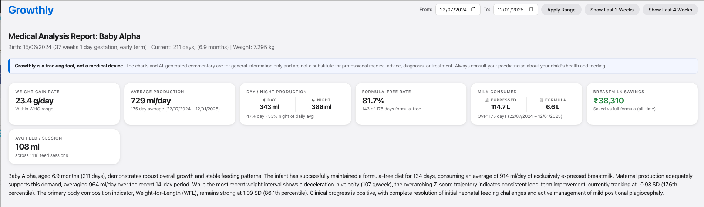
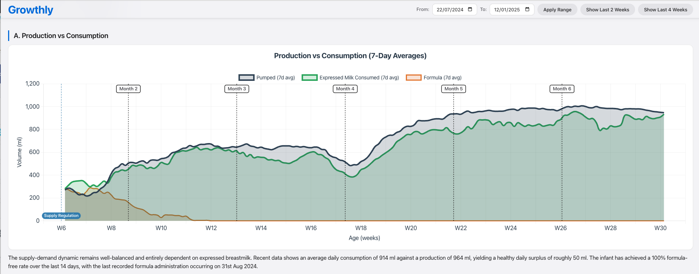
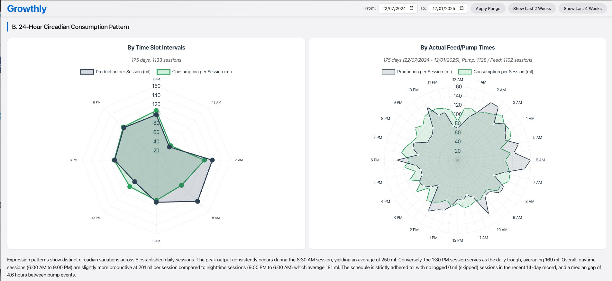
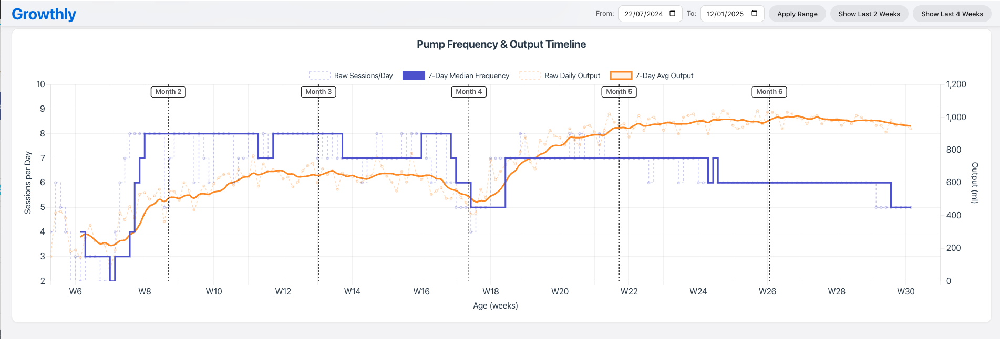
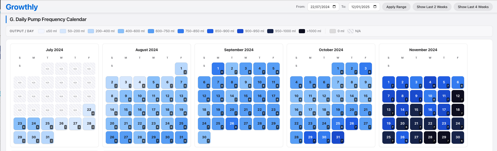

# Growthly

An interactive analysis dashboard for an infant's feeding, pumping, and growth data. It turns a daily feeding/pumping log (kept in an Excel workbook) into WHO-referenced growth charts, production/consumption analytics, a pump calendar, a formula-cost breakdown, and an AI-written clinical narrative.

`npm start` runs the pipeline and serves the app:
`parse Excel → build prompt → (AI or manual) → ng serve`.



|  |  |
| --- | --- |
|  |  |
|  |  |

---

## Working modes: AI or manual

The clinical narrative on the dashboard is written by an LLM from the Excel data. How that happens depends on the mode — AI or manual. The mode is auto-detected (AI if `GEMINI_API_KEY` is set, otherwise manual), or it can be forced:

```bash
npm run start:ai        # force AI mode (falls back to manual if no key)
npm run start:manual    # force manual mode, even if a key is set
npm start               # auto-detect
```

**AI mode** — the pipeline calls Google Gemini and writes`public/inference/inference.json` automatically. Set the key first:

```bash
export GEMINI_API_KEY=...         # macOS/Linux  (Windows: setx GEMINI_API_KEY ...)
npm start
```

The default model is `gemini-2.5-flash`; override it with `GEMINI_MODEL` (e.g. `export GEMINI_MODEL=gemini-2.5-pro`). Get a key from Google AI Studio.

**Manual mode** — no key (or `start:manual`). The prompt is **copied to theclipboard and printed in the console**. Then:

1. Paste the prompt into any LLM (ChatGPT, Claude, …) and let it answer.
2. Copy the JSON object it returns.
3. Run **`npm run apply`** — it reads that JSON from the clipboard, validates it,
   and writes `public/inference/inference.json`.

Until it is applied, the dashboard keeps the previous `inference.json`, but the charts and stats update from the data.

---

## Data

The app reads everything from `data-source/Feeding Log.xlsx`, which needs to be filled with feeding, pumping, and growth data. `npm run data` turns it into the files under `generated/`, which are regenerated on each run and so are not edited directly.

## Customizing the report (optional)

`PERSONA` and `taskGuide()` in `scripts/prompt-template.js` control the narrative's tone and content. They can be edited or left as they are. `HTML_FORMAT_RULES` is best left unchanged unless the dashboard CSS is also changing.

## Running

```bash
npm install
npm start          # runs the pipeline, then serves http://localhost:4200
```
